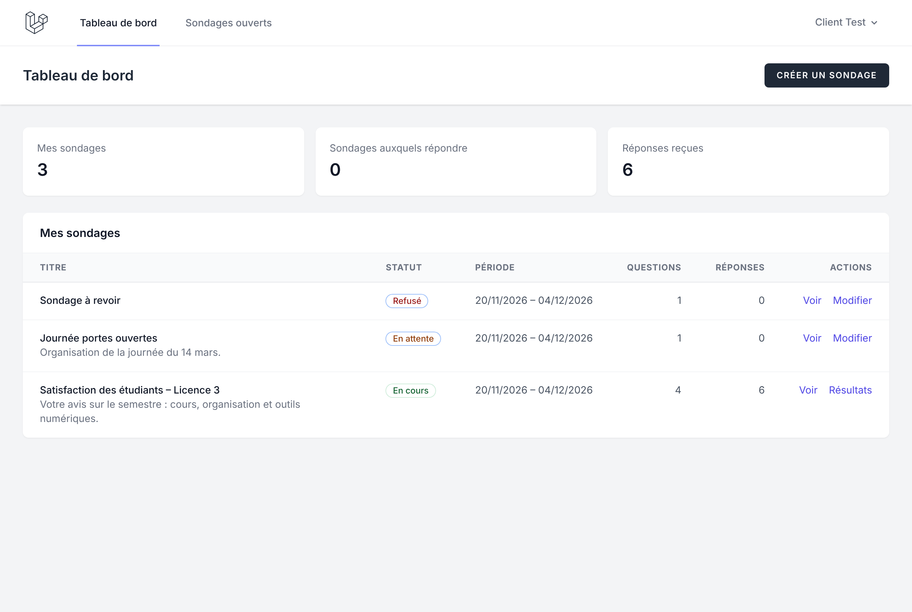
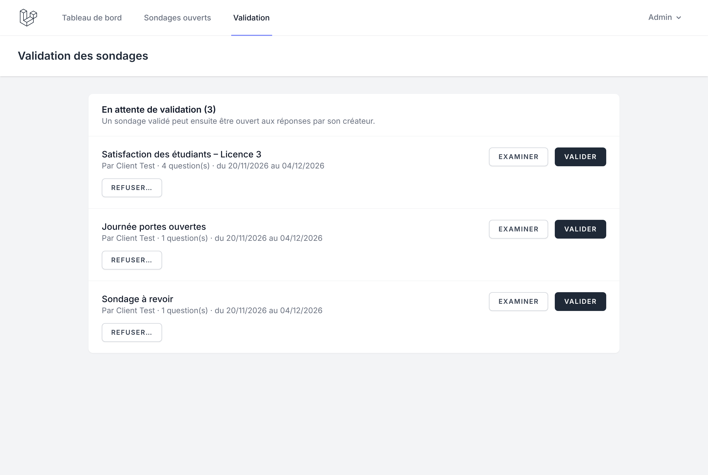
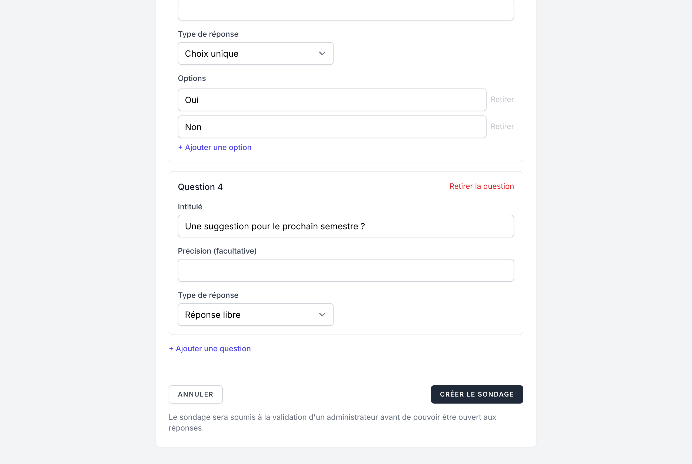
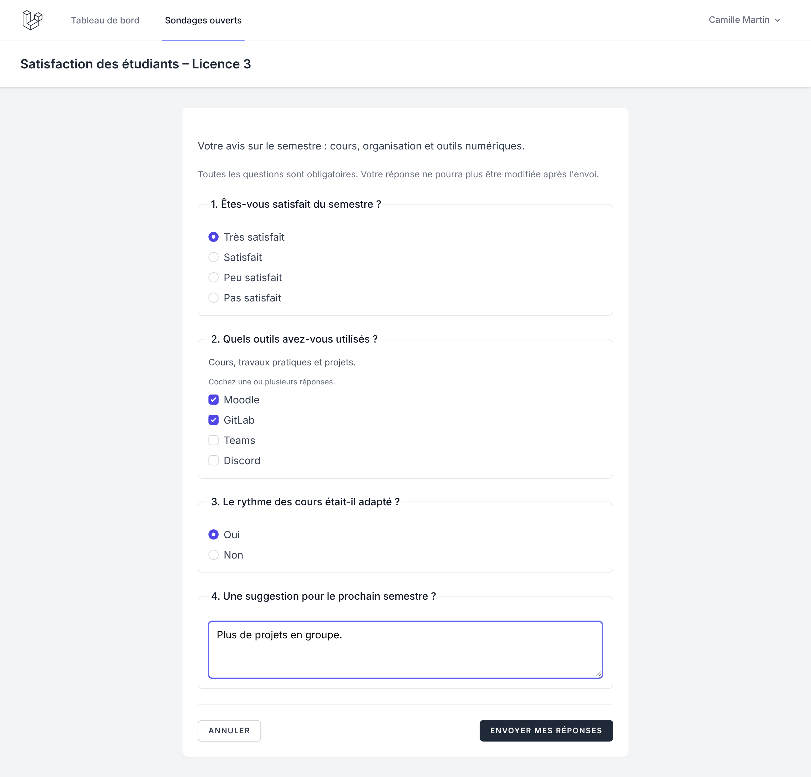
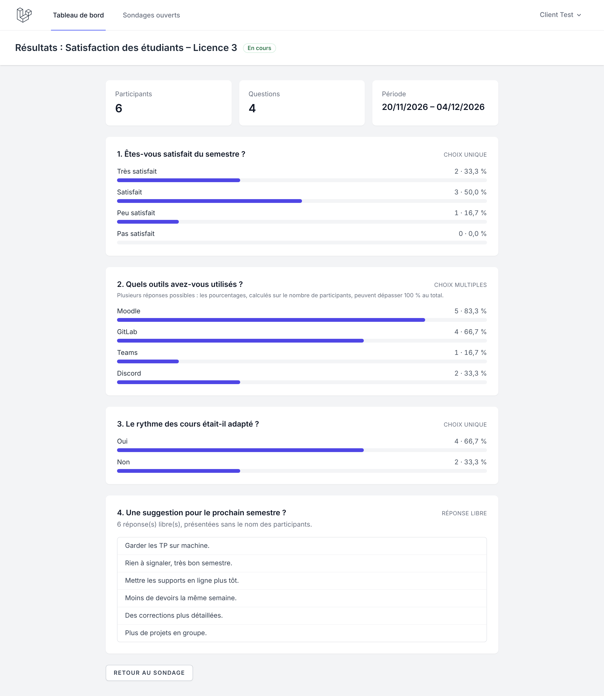

# Plateforme de gestion de sondages

**Laravel 11 · PHP 8.2 · Tailwind CSS · Alpine.js · SQLite / MySQL · PHPUnit**

Application web de sondages en ligne : un client crée un sondage, un administrateur le valide, le sondage est ouvert aux participants, puis son créateur consulte les résultats. Chaque étape est contrôlée par des rôles et des règles d'accès, et couverte par des tests automatisés.

Projet universitaire (Université de Reims Champagne-Ardenne) réalisé à deux, voir [Contributeurs](#contributeurs).

## Parcours d'un sondage

| Étape | Qui | Statut obtenu |
|---|---|---|
| 1. Création du sondage et de ses questions | Client (ou administrateur) | En attente |
| 2. Validation, ou refus avec un motif | Administrateur | Validé / Refusé |
| 3. Ouverture aux réponses | Créateur du sondage | En cours |
| 4. Réponse des participants, une fois chacun | Utilisateurs connectés | En cours |
| 5. Clôture et consultation des résultats | Créateur (ou administrateur) | Terminé |

Un sondage refusé ou validé peut être modifié par son créateur : il repasse alors « En attente » et doit de nouveau être validé. Un créateur ne peut pas valider son propre sondage, sauf s'il est administrateur.

## Aperçu

| Tableau de bord du créateur | Validation par un administrateur |
|---|---|
|  |  |
| **Création d'un sondage** | **Réponse d'un participant** |
|  |  |

**Résultats d'un sondage** (6 participants)



## Fonctionnalités

- **Création et modification** : titre, description, période de réponse et jusqu'à 30 questions de trois types (réponse libre, choix unique, choix multiples). Les questions et les options sont modifiables tant que le sondage n'est pas ouvert. Les erreurs de saisie sont affichées en français, sans perte de ce qui a été saisi.
- **Validation** : un administrateur valide ou refuse les sondages en attente. Le motif d'un refus est affiché au créateur.
- **Participation** : les sondages ouverts sont proposés aux autres utilisateurs pendant leur période de réponse. Toutes les questions sont obligatoires et une seule réponse est acceptée par participant.
- **Résultats** : nombre de participants, effectifs et pourcentages par option, réponses libres présentées sans le nom des participants.
- **Contrôle d'accès** : chaque action est vérifiée côté serveur par une politique d'accès (`SondagePolicy`) et par les permissions des rôles. Une action non autorisée renvoie une erreur 403.
- **Fiabilité** : un sondage et ses questions sont enregistrés dans une transaction. Les réponses en double sont refusées par l'application et par un index unique en base de données.

## Rôles

| Rôle | Créer des sondages | Valider ou refuser | Répondre | Voir les résultats |
|---|:---:|:---:|:---:|:---:|
| Administrateur | ✅ | ✅ | ✅ | ✅ tous les sondages |
| Client | ✅ | — | ✅ | ses sondages |
| Commercial, Sondeur | — | — | ✅ | — |

Un administrateur peut aussi consulter et supprimer le sondage d'un autre utilisateur, sauf s'il est en cours. Les rôles et leurs permissions sont gérés avec spatie/laravel-permission et créés par les migrations. Un compte créé depuis la page d'inscription reçoit le rôle « client ».

## Technologies et architecture

- **Back-end** : PHP 8.2+, Laravel 11, Eloquent, Laravel Breeze (authentification), spatie/laravel-permission
- **Front-end** : vues Blade, Tailwind CSS et Alpine.js compilés avec Vite
- **Base de données** : SQLite par défaut, ou MySQL
- **Tests** : PHPUnit (tests de fonctionnalités Laravel)

```text
app/Http/Controllers/   Sondages, validation, participation, résultats, tableau de bord
app/Http/Requests/      Validation d'un sondage et de ses questions
app/Policies/           Règles d'accès (SondagePolicy)
app/Enums/              Statuts d'un sondage
app/Models/             Sondage, Question, Option, Participation, ParticipationReponse, User
database/migrations/    Schéma de la base, rôles et permissions
resources/views/        Vues Blade
lang/fr/                Messages en français
tests/Feature/          Tests de fonctionnalités
```

## Installation

**Prérequis** : PHP 8.2+ (avec `pdo_sqlite` ou `pdo_mysql`), Composer, Node.js 18, 20 ou 22+ et npm.

```bash
git clone https://github.com/tiss0039/Plateforme-de-gestion-de-sondages.git
cd Plateforme-de-gestion-de-sondages
composer install
cp .env.example .env
php artisan key:generate
npm ci
npm run build
```

**Base de données SQLite** (configuration par défaut) :

```bash
touch database/database.sqlite
php artisan migrate --seed
```

Sous Windows, créez un fichier vide `database/database.sqlite` au lieu d'utiliser `touch`.

**Base de données MySQL** : créez une base vide, renseignez `DB_CONNECTION=mysql` et les paramètres `DB_*` dans `.env`, puis lancez `php artisan migrate --seed`.

**Lancement** :

```bash
php artisan serve
```

L'application est accessible sur <http://127.0.0.1:8000>. En local, les e-mails (mot de passe oublié) sont écrits dans `storage/logs/laravel.log`.

### Comptes de démonstration

Créés par `php artisan migrate --seed`, avec le mot de passe `password` (développement local uniquement) :

| E-mail | Rôle |
|---|---|
| `admin@example.com` | Administrateur |
| `client@example.com` | Client |
| `commercial@example.com` | Commercial |
| `sondeur@example.com` | Sondeur |

### Mise à jour d'une base existante

Les nouvelles migrations sont additives : `php artisan migrate` ajoute les tables de participation, les colonnes de validation et les rôles manquants, sans modifier ni supprimer de données. Les comptes créés auparavant n'ont pas de rôle. Pour en attribuer un :

```bash
php artisan tinker --execute="App\Models\User::where('email', 'adresse@exemple.fr')->first()->assignRole('client');"
```

Une base créée avec les toutes premières migrations du projet, qui créaient certaines tables deux fois, ne peut pas être mise à jour. Elle doit être recréée avec `php artisan migrate:fresh --seed`, ce qui **efface toutes ses données**.

## Tests

```bash
npm run build      # les pages testées chargent les assets compilés
php artisan test
```

Les 97 tests couvrent :

- l'authentification et l'inscription ;
- les rôles et les permissions ;
- la création et la modification des sondages et de leurs questions, y compris les saisies invalides ;
- la validation par un administrateur et l'interdiction de valider son propre sondage ;
- l'ouverture et la clôture d'un sondage ;
- les réponses : types de questions, réponses invalides, réponse en double, dates et droits ;
- le calcul des résultats et leur accès ;
- un parcours complet, de la création aux résultats.

Les tests s'exécutent sur une base SQLite en mémoire définie dans `phpunit.xml`. Un garde-fou (`tests/TestCase.php`) les interrompt avant toute opération si la connexion pointe vers une autre base, ce qui protège la base de développement.

## Limites connues

- Les rôles « commercial » et « sondeur » peuvent seulement répondre aux sondages. L'affectation de sondages à des sondeurs, prévue à l'origine (table `sondage_assignments`), n'est pas implémentée.
- Il faut un compte pour répondre : pas de lien de participation anonyme. Une réponse envoyée ne peut plus être modifiée.
- Un sondage n'est pas clôturé automatiquement à sa date de fin : les réponses sont refusées après cette date, mais le statut reste « En cours » jusqu'à la clôture par son créateur.
- Pas d'export des résultats ni de notification par e-mail aux différentes étapes d'un sondage.
- Les anciennes tables `reponses` et `stockage_reponses` sont conservées, mais l'application ne les utilise plus.
- Il n'existe ni application mobile ni API REST.

## Contributeurs

- **Wang0036** : création du projet Laravel, premiers modèles et premières migrations (sondages, questions, options, réponses), intégration de spatie/laravel-permission avec les rôles et permissions d'origine, pages d'erreur.
- **Ela Tissaoui** ([tiss0039](https://github.com/tiss0039)) : contrôleurs et vues des sondages, statuts, authentification Breeze, schéma de base de données révisé, comptes de démonstration ; puis, en 2026, reprise du projet : parcours complet (validation, participation, résultats), interface unifiée, rôles appliqués et tests.
